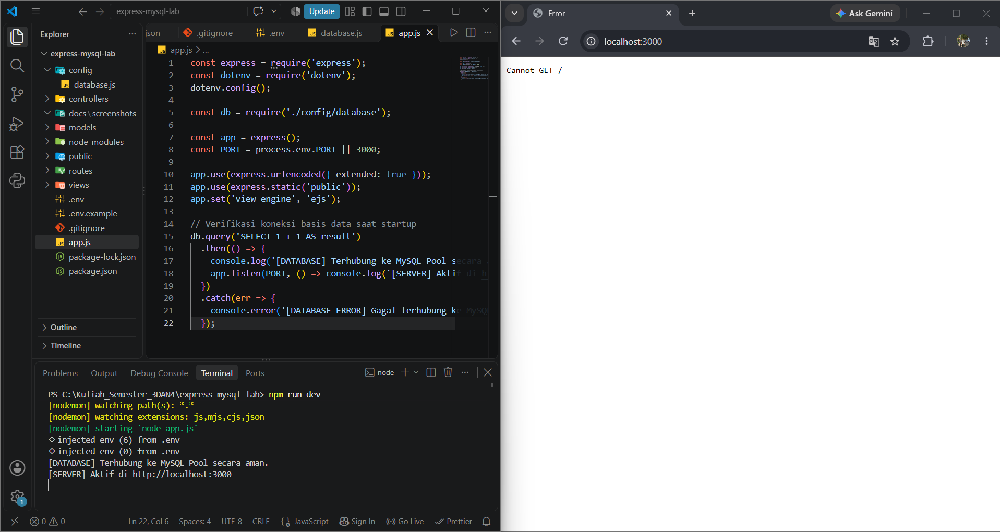
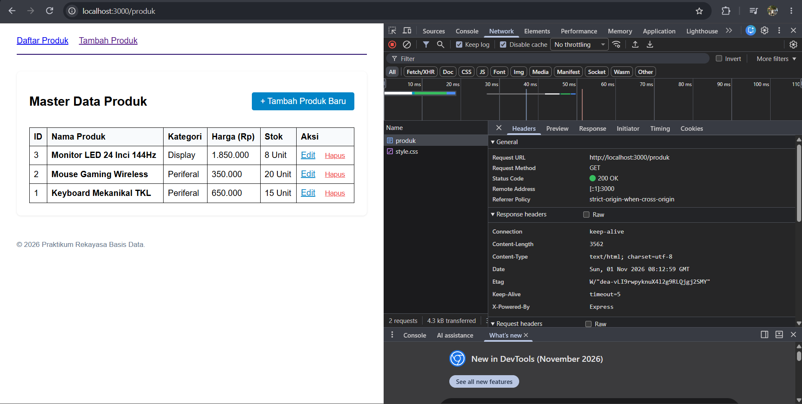
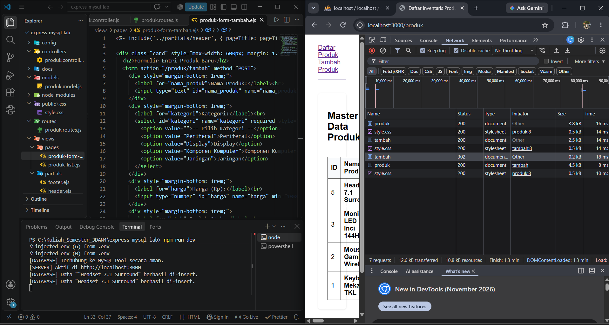
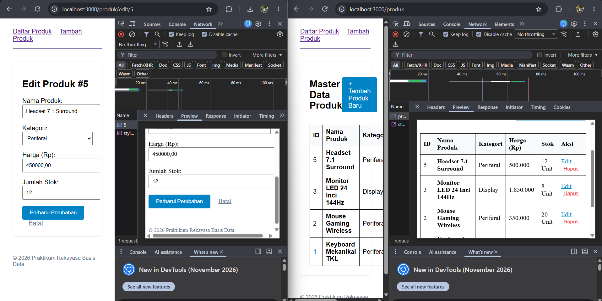
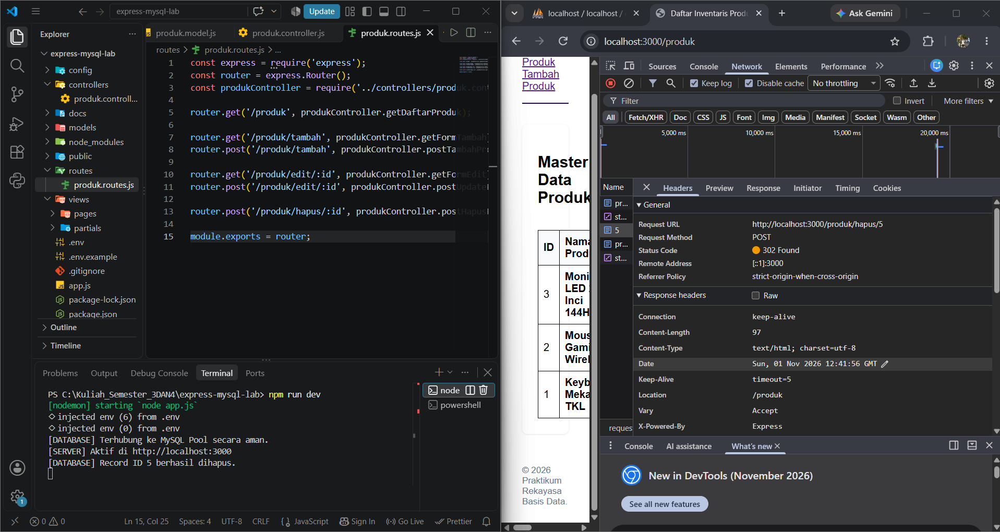
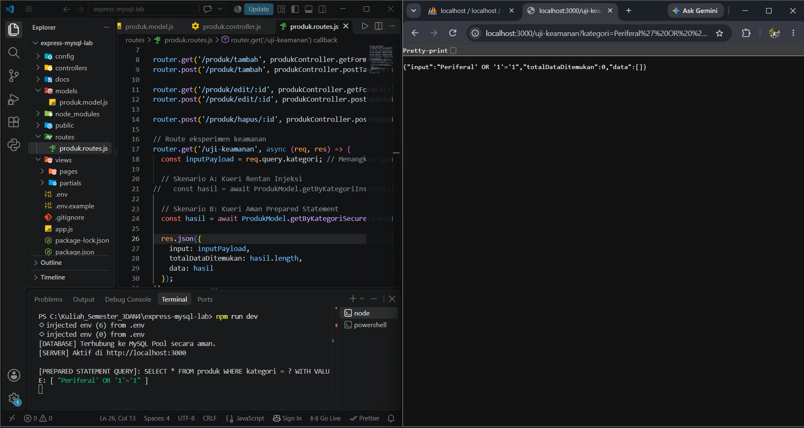
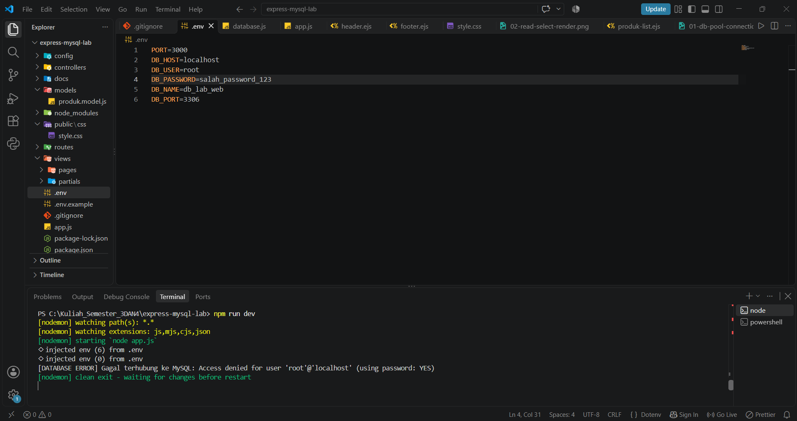
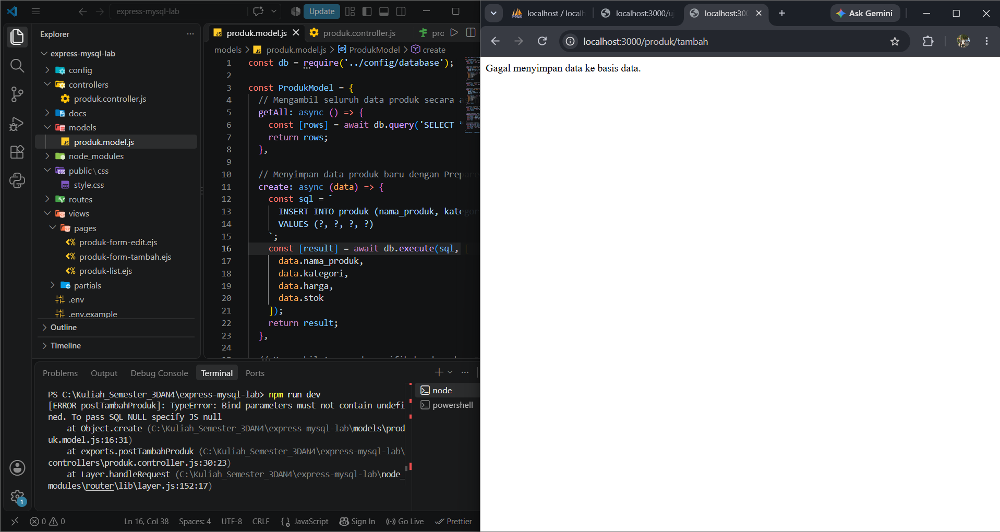

# Praktikum 3: Express.js, MySQL, Connection Pooling, dan Prepared Statements

Modul Praktikum 3 Mata Kuliah Pemrograman Web (MK11).
PRAKTIK REKA Y ASA SISTEM BASIS DA T A: PERSISTENSI MYSQL, CONNECTION POOLING, PREP ARED ST A TEMENTS, DAN ARSITEKTUR CRUD AMAN.

| | |
|---|---|
| **Nama** | [I Made Dandi Prayata Ardana] |
| **NIM** | [42530009] |
| **Kelas** | [Pemrograman Web] |

## Deskripsi

Aplikasi web untuk mengelola data inventaris produk. Pengguna dapat melihat daftar produk, menambah, mengubah, dan menghapus data yang tersimpan secara persisten di MySQL. Praktikum ini juga membuktikan secara empiris bahwa Prepared Statements kebal terhadap serangan SQL Injection.

### Matriks Penelusuran Pengujian (Traceability Matrix)

| ID Uji | Fitur / Operasi | Target Endpoint URL | HTTP Method | Skenario Pengujian | Hasil yang Diharapkan | Status | Bukti Tangkapan Layar |
|---|---|---|---|---|---|---|---|
| TC-01 | Koneksi Pool | App Startup | - | Server dijalankan pertama kali | Terhubung ke MySQL Pool tanpa error | Pass |  |
| TC-02 | Read (All) | `/produk` | GET | Akses halaman daftar produk | Menampilkan seluruh record tabel MySQL ke antarmuka EJS | Pass |  |
| TC-03 | Create | `/produk/tambah` | POST | Submit formulir produk baru | Data tersimpan di DB, DevTools mencatat 302 Redirect ke `/produk` | Pass |  |
| TC-04 | Update | `/produk/edit/:id` | POST | Mengubah harga & stok produk | Nilai kolom pada baris MySQL berubah sesuai input baru | Pass |  |
| TC-05 | Delete | `/produk/hapus/:id` | POST | Eksekusi tombol hapus produk | Baris record terhapus dari MySQL dan UI ter-refresh | Pass |  |
| TC-06 | Keamanan | `/uji-keamanan` | GET | Input `' OR '1'='1` via URL | Prepared Statement memperlakukan input sebagai literal string (No Injection) | Pass |  |

### Laboratorium Investigasi Masalah (Troubleshooting)

| Kasus | Pemicu | Galat yang Muncul | Penyebab | Perbaikan | Bukti Tangkapan Layar |
|---|---|---|---|---|---|
| 1 | `DB_PASSWORD` di `.env` diubah menjadi salah | `ER_ACCESS_DENIED_ERROR` | Autentikasi MySQL ditolak sebelum query dijalankan | Kembalikan `DB_PASSWORD` yang benar, restart server |  |
| 2 | Atribut `name="harga"` diubah menjadi `harga_produk` | `Bind parameters must not contain undefined` | `req.body.harga` bernilai `undefined` karena nama field tidak cocok | Samakan `name` di form dengan variabel di controller |  |
| 3 | `connectionLimit: 1` dan koneksi tidak dilepas | Request menggantung (loading terus) | Pool kehabisan koneksi bebas | Kembalikan `connectionLimit: 10`, gunakan `pool.promise()` | - |
